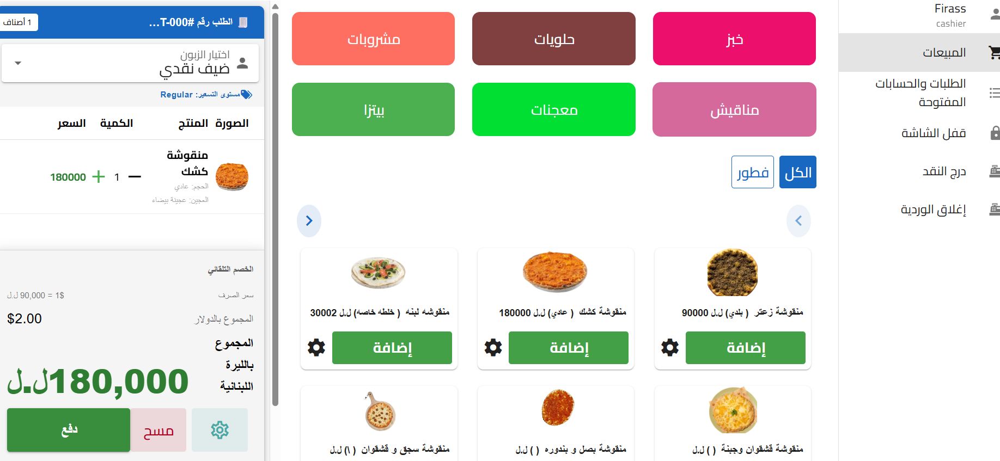
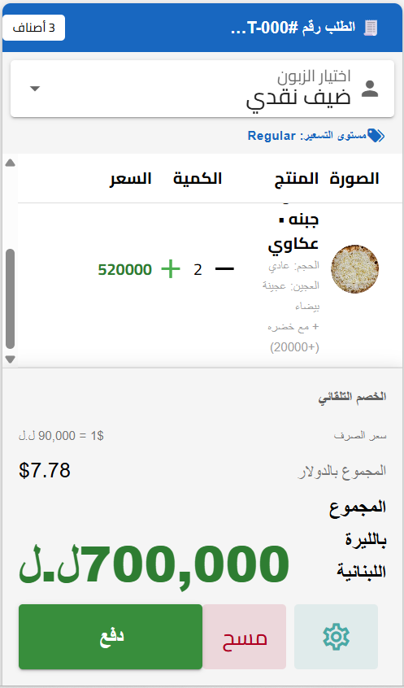
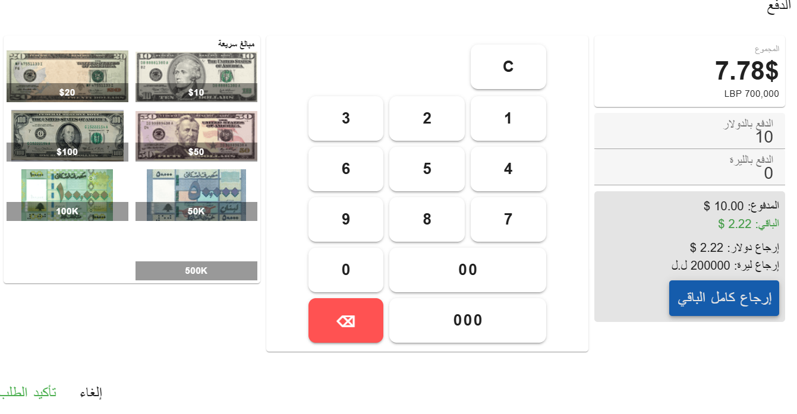

# 🧾 Bakery POS & Business Management System

A full-stack **Point of Sale (POS) and business management system** designed for bakery operations.

The project has been under active development for approximately **4 months**, with a focus on building a complete sales and business management workflow.

The system currently covers **POS sales, product management, promotions, customer management, payments, refunds, exchanges, cash drawer operations, cashier shifts, reporting, data visualization, and multilingual support**.

The application is also being prepared for deployment as a **desktop application using Electron**.

The long-term goal is to develop a complete bakery management platform covering **sales, inventory, cashier operations, kitchen workflows, barcode integration, and business analytics**.

---

# 🚀 Project Overview

### Currently Implemented

- 🛒 Point of Sale & Sales Management
- 📦 Product & Catalog Management
- 🎁 Promotions & Discounts
- 👥 Customer Management
- 💳 Multi-Currency Payment Processing
- 💱 Refund & Exchange Management
- 💵 Cash Drawer Management
- 🕐 Cashier Shift Management
- 📊 Shift Reports & Data Visualization
- 🌍 English & Arabic Interface
- 🔐 Authentication & Admin Management

### In Progress

- 🖥️ Electron Desktop Application

### Planned

- 🧾 Barcode Scanner & Label Printing
- 📦 Inventory Management
- 👨‍🍳 Kitchen Management System
- 📊 Advanced Business Analytics
- 🔐 Role-Based Access Control

---

# 🛠️ Technology Stack

## Frontend

- Vue.js
- Vite
- Vuetify
- Pinia
- Vue Router
- Vue I18n
- JavaScript

## Backend

- Node.js
- Express.js
- REST API

## Database

- MySQL
- Relational database design

## Desktop

- Electron *(In Progress)*

---

# 🛒 POS Sales System

The POS interface is designed for fast cashier interaction while maintaining a clear overview of the current customer order.

## Product Browsing

Cashiers can browse products through categories and subcategories.




### Features

- Category browsing
- Subcategory browsing
- Product search
- Product variants
- Sizes
- Dough options
- Product configuration

---

## POS Cart

The cart manages products, quantities, customers, discounts, and order totals.



### Features

- Add/remove products
- Quantity management
- Customer selection
- Order totals
- Discounts
- Promotions
- Product options
- Order management

---

## Payment Processing

The payment system supports both **USD and Lebanese Pounds (LBP)**.




### Features

- USD payments
- LBP payments
- Mixed USD/LBP payments
- Exchange-rate handling
- Change calculation
- Payment status tracking
- Order payment processing

---

# 🎁 Promotions Management

The promotion module allows administrators to create and manage promotional campaigns without modifying the underlying sales logic.

> 📸 Add screenshot here
>
> `screenshots/promotions.png`

## Promotion Types

The system supports:

- Percentage discounts
- Fixed-value discounts
- BOGO — Buy One Get One
- Bundle promotions

## Promotion Targeting

Promotions can be applied to:

- Global customers
- Customer groups
- Individual customers
- Product groups

## Promotion Scheduling

Administrators can configure:

- Start dates
- End dates
- Priority
- Activation status
- Budget limits
- Promotion usage tracking

---

# 📦 Product Management

The product management module provides administrators with a structured product catalog.

> 📸 Add screenshot here
>
> `screenshots/products.png`

### Features

- Products
- Categories
- Subcategories
- Product groups
- Product variants
- Sizes
- Dough options
- Units
- Pricing
- Product configuration

The database uses a relational product structure that allows different product groups to support different combinations of sizes, dough types, variants, and units.

---

# 👥 Customer Management

The customer management module allows administrators to manage customer information and customer groups.

> 📸 Add screenshot here
>
> `screenshots/customers.png`

### Features

- Customer profiles
- Customer codes
- Contact information
- Customer groups
- Customer history
- Customer-specific promotions

### Customer Groups

Example customer groups include:

- VIP
- Family
- Staff
- Regular

---

# 💱 Refund & Exchange Management

The system includes workflows for handling post-sale refunds and product exchanges while maintaining the original transaction history.

> 📸 Add screenshot here
>
> `screenshots/refunds-exchanges.png`

## Refunds

- Full refunds
- Partial item refunds
- Returned quantity tracking
- Refund transaction records

## Exchanges

- Select products for exchange
- Return original products
- Select replacement products
- Calculate exchange balances
- Track exchanged quantities
- Prevent duplicate exchanges

The original order remains intact while refund and exchange operations are recorded separately.

---

# 💵 Cash Drawer Management

The cash drawer module tracks physical cash handled by each cashier.

> 📸 Add screenshot here
>
> `screenshots/cash-drawer.png`

### Features

- Opening cash
- USD balance
- LBP balance
- Cash-in transactions
- Cash-out transactions
- Expected cash calculation
- Closing cash
- Cash variance
- Cashier-specific transactions

The system dynamically calculates expected cash based on:

```text
Opening Cash
+ Sales
+ Cash In
- Cash Out
- Returns
= Expected Cash
